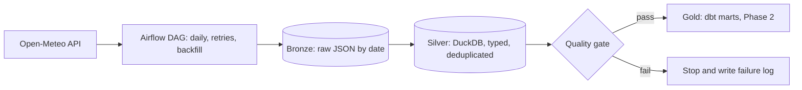

# Air Quality Data Pipeline: Airflow, DuckDB, Medallion Architecture

A daily batch pipeline that pulls hourly air quality data (PM10 and PM2.5) for 8 Indian cities from the free Open-Meteo API. It lands the raw JSON (Bronze), cleans and types it in DuckDB (Silver), and validates every day with an automated quality gate. Orchestrated with Apache Airflow 3.

> **Status:** Phase 1 (ingestion, orchestration, Silver layer, quality gate) is complete. Phase 2 (dbt Gold models and tests, pytest, CI) is next.

## Architecture



## Results from the real runs

| Metric | Value |
|---|---|
| Cities | 8 |
| Days of data in Silver | 31 (2026-09-29 to 2026-10-29) |
| Rows in Silver | 5952 (8 cities x 24 hours x 31 days) |
| Duplicate city/hour rows | 0 |
| Successful DAG runs (aqi_medallion) | 31 of 31 |
| Quality gate passes | 30 |

## Design decisions

- **Idempotent loads.** Bronze files are overwritten per date, and Silver deletes and re-inserts a date inside one transaction. Re-running a day never creates duplicates, and 15 days were re-processed through Airflow to prove it.
- **Dynamic task mapping.** One extract task per city, so adding a city is a one-line change.
- **Retries at two levels.** Airflow retries failed tasks (2 retries, 1 minute apart), and the extract function retries network errors with exponential backoff.
- **Quality gate.** After Silver, the DAG checks row count, city count, duplicates, null share and PM2.5 range, and stops before anything downstream if data is bad. The gate task does not retry, because bad data does not fix itself.
- **Small XCom payloads.** Tasks pass file paths, never data.
- **Failure callback: failed tasks append a line to `data/failures.log`. Verified with the `failure_demo` DAG.**
- **Schedule.** Uses Airflow's interval timetable, so each scheduled run processes the previous complete day (never a partial day).
- **Timestamps in UTC.** Conversion to local time happens only at presentation.

## Lessons learned

- Airflow's default SQLite metadata database allows one writer at a time. Creating many backfill runs at once while the scheduler runs caused `database is locked`. I fixed it by backfilling in small chunks with retries. Production would use Postgres.
- DuckDB also allows one writer, so the DAG uses `max_active_runs=1`.
- Airflow 3 changed bare cron schedules to a trigger-based timetable, which affects which date a scheduled run processes.

## Project structure

```text
airflow/dags/aqi_medallion.py   main DAG: extract (mapped), load Silver, quality gate
airflow/dags/failure_demo.py    deliberately failing DAG used to test the failure callback
src/extract.py                  API call with backoff, Bronze writer
src/load_silver.py              typed, deduplicated, idempotent DuckDB load
src/quality.py                  data quality checks
src/callbacks.py                failure callback
sql/window_functions_practice.sql   RANK, LAG, rolling average, ROW_NUMBER on Silver
sql/silver_gap_check.sql        finds missing days in Silver
scripts/run_sql.py              runs a .sql file against the DuckDB warehouse
airflow_env.sh                  sets AIRFLOW_HOME to this project
```

## Run it yourself

```bash
python -m venv .venv && source .venv/bin/activate
AIRFLOW_VERSION=3.3.0
PYTHON_VERSION="$(python --version | cut -d ' ' -f 2 | cut -d '.' -f 1-2)"
pip install "apache-airflow==${AIRFLOW_VERSION}" --constraint "https://raw.githubusercontent.com/apache/airflow/constraints-${AIRFLOW_VERSION}/constraints-${PYTHON_VERSION}.txt"
pip install duckdb requests
source airflow_env.sh
python src/extract.py 2026-10-28 && python src/load_silver.py 2026-10-28 && python src/quality.py 2026-10-28
airflow standalone
```

Backfill a date range: `airflow backfill create --dag-id aqi_medallion --from-date 2026-10-01 --to-date 2026-10-03 --max-active-runs 1 --reprocess-behavior completed`

## Roadmap (Phase 2)

- [ ] dbt Gold models: daily city averages, AQI category, 7-day rolling average
- [ ] dbt tests (unique, not_null, accepted_values, PM2.5 range) and an incremental model
- [ ] Airflow task that runs `dbt build` after the quality gate
- [ ] pytest unit tests for the extract function
- [ ] GitHub Actions CI (lint, pytest, dbt test)
